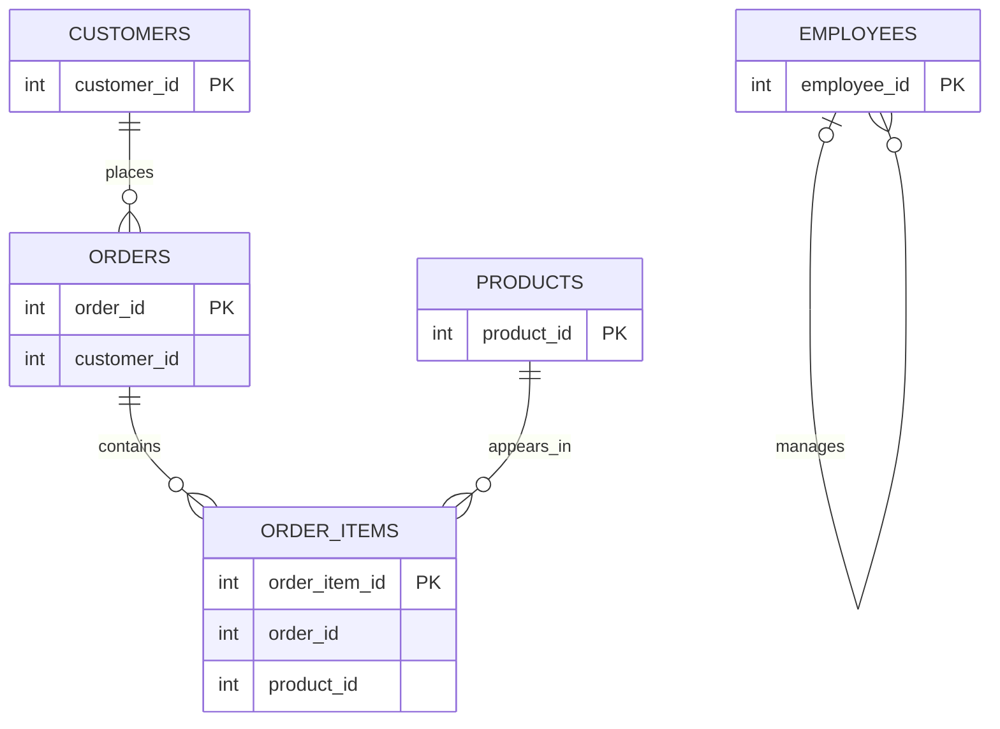

# Database Entity Relationship Diagram

## Overview
This document describes the logical data model for the synthetic retail database.

The database contains five tables: customers, products, orders, order_items and employees.

## Entity Relationships

## Relationship Descriptions
1. **Customers and Orders (One-to-Many):** One customer can place multiple orders. Each order is intended to belong to one customer.
2. **Orders and Order Items (One-to-Many):** One order can contain multiple order items. Each order item is intended to belong to one order.
3. **Products and Order Items (One-to-Many):** One product can appear in multiple order items. Each order item is intended to reference one product.
4. **Orders and Products (Many-to-Many):** One order can contain multiple products, and one product can appear in multiple orders. This many-to-many relationship is implemented through the `order_items` junction table.
5. **Employees (Self-Referencing Relationship):** Based on the schema documented, there is no declared relationship between employees and customers, products, orders, or order_items.

   However, the `manager_id` column potentially establishes a relationship within the employees table itself:

   - One manager can manage multiple employees.
   - An employee can have one manager.
   - A top-level employee may have no manager (`manager_id` is NULL).

   This is called a **self-referencing** or **recursive relationship**. The `manager_id` column is intended to reference another employee's `employee_id`.

   The actual foreign-key constraint and validity of these references have not yet been verified.

The `order_items` table acts as a junction table between orders and products.

## Data Integrity Considerations
The current practice database uses primary keys but does not enforce foreign-key constraints.

The relationships shown represent the intended logical structure. Data-quality validation queries are used to identify invalid references and other data issues.

## Future Improvements
- Implement and test foreign-key constraints.
- Document all columns and their data types.
- Define mandatory and optional fields.
- Introduce business rules and validation constraints.
- Expand automated data-quality testing.
