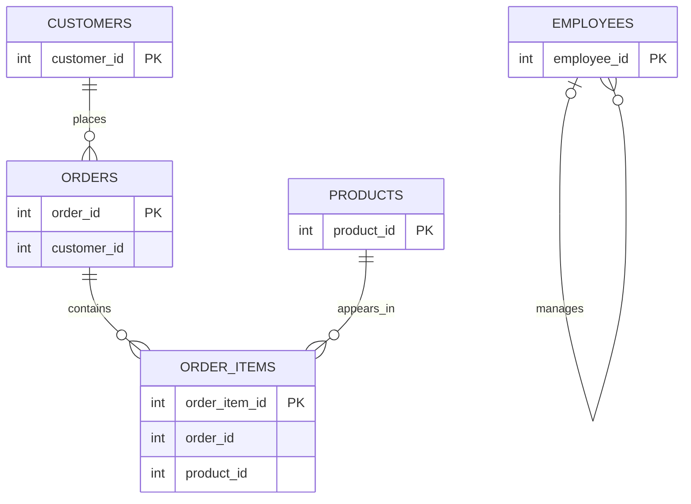

# Database Entity Relationship Diagram

## Overview
This document describes the logical data model for the synthetic retail database.

The database contains five tables: customers, products, orders, order_items and employees.

## Entity Relationships

## Relationship Descriptions
1. Customers and Orders: One customer can place multiple orders. Each order is intended to belong to one customer.
2. Orders and Order Items: One order can contain multiple order items.
3. Products and Order Items: One product can appear in multiple order items.

The `order_items` table acts as a junction table between orders and products.

## Data Integrity Considerations
The current practice database uses primary keys but does not enforce foreign-key constraints.

The relationships shown represent the intended logical structure. Data-quality validation queries are used to identify invalid references and other data issues.

## Future Improvements
- Implement and test foreign-key constraints.
- Document all columns and their data types.
- Define mandatory and optional fields.
- Introduce business rules and validation constraints.
- Expand automated data-quality testing.
